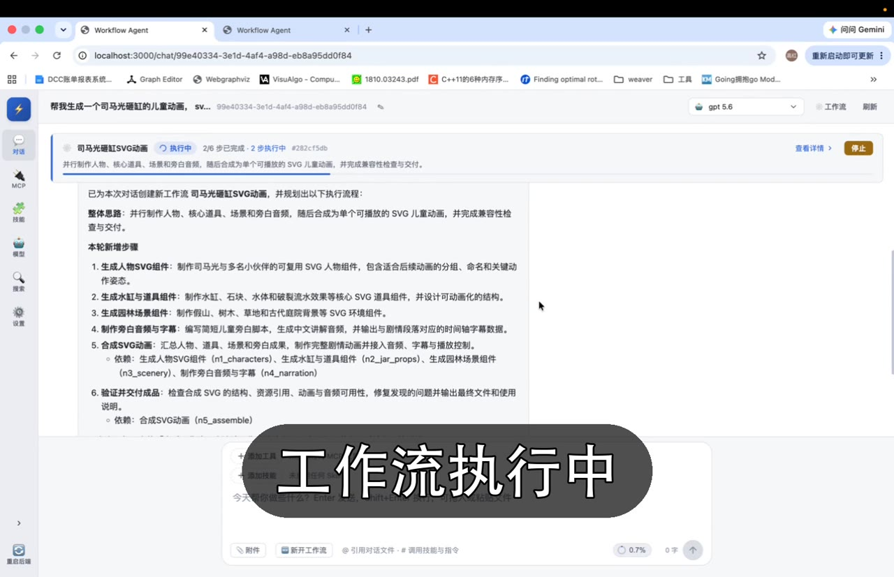

# flowagent

> Language: [English](README.md) · [中文](README.zh-CN.md)

A conversation-driven workflow orchestration framework — turn natural-language conversations into parallel DAG task graphs, executed with built-in MCP tools, skills, and context engineering. Built with Go + React.

## Table of Contents

- [Demo](#demo)
- [Quick Start](#quick-start)
- [Why flowagent](#why-flowagent)
- [Features](#features)
- [Two ways to use](#two-ways-to-use)
- [API Overview](#api-overview)
- [Documentation](#documentation)
- [Contributing](#contributing)
- [Star History](#star-history)
- [License](#license)

## Demo

A quick walkthrough of the core loop: add a model, start a conversation, and watch flowagent plan the request into a DAG workflow and execute it in parallel.

**▶ [Watch the demo video](docs/demo.mp4)**

[](docs/demo.mp4)

## Quick Start

Run flowagent with its built-in web UI:

### Prerequisites

- Go 1.25+
- Node.js 18+

### 1. Install dependencies

```bash
# Linux / macOS
bash install.sh

# Windows
install.bat
```

This checks Go / Node.js / Python, generates a default `config/config.yaml` (SQLite, zero-dependency), builds the backend, installs frontend dependencies, and sets up skill runtime dependencies.

> **Slow network (e.g. in China)?** Set a PyPI mirror before installing — pip and uv read these env vars respectively:
>
> ```bash
> export PIP_INDEX_URL=https://pypi.tuna.tsinghua.edu.cn/simple      # pip: base libs, pdfkit, etc.
> export UV_DEFAULT_INDEX=https://pypi.tuna.tsinghua.edu.cn/simple   # uv: browser-use
> ```
>
> Persist them in `~/.bashrc` or `~/.zshrc` for permanent effect.

### 2. Start

```bash
# Linux / macOS
bash start.sh

# Windows
start.bat
```

This launches agent-server + agent-scheduler + the frontend. Open the frontend URL to chat and inspect DAG workflows.

### 3. Stop

```bash
# Linux / macOS
bash stop.sh

# Windows
stop.bat
```

This stops the services started above — only the processes under this project directory, leaving instances elsewhere untouched.

## Why flowagent

1. **An easy-to-integrate, feature-complete open-source agent framework is missing.** Today there is no great open-source agent framework that enterprises or individuals can plug in directly — you either reinvent the wheel from scratch, or lock yourself into a cloud provider's hosted agent. flowagent aims to be exactly that: easy to integrate and feature-complete.

2. **ReAct is serial and slow; DAG parallelism accelerates long-horizon tasks.** Most existing agents follow the ReAct loop, which executes planned steps strictly one-by-one, making long-running tasks slow. flowagent plans tasks into a **DAG** and executes independent sub-tasks **in parallel**, dramatically accelerating long-horizon tasks.

## Features

- **Conversation → DAG planning**: plan a natural-language request into a directed acyclic graph (DAG) of sub-tasks, with `depends_on` expressing dependencies.
- **Parallel sub-task scheduling**: independent sub-tasks run in parallel, with upstream outputs piped into downstream nodes.
- **Context engineering**: compaction, indexing, and recall keep long-running agents coherent.
- **MCP tool protocol**: integrate external tools via the Model Context Protocol, with stdio / SSE / streamable_http transports.
- **Built-in skill system**: first-party skills (docx / pptx / shell) plus bundled third-party skills (pdfkit-py, minimax-xlsx).
- **Multiple workflows per conversation**: one chat can drive several workflows, with incremental node updates and versioning.
- **Complete debugging trail**: every task preserves a full execution trace — planning thought process, MCP tool-call records (input / output / latency), task turns, context usage, and failure reasons — plus built-in pprof endpoints (block / mutex profiling) for performance analysis.

## Two ways to use

### 1. Use the built-in frontend

flowagent ships a complete web UI with chat, workflow DAG visualization, model configuration, and MCP/skill management. See [Quick Start](#quick-start) to get running.

### 2. Use flowagent as your core agent engine (API)

Treat flowagent as the "agent kernel" of your own project and drive it over HTTP. Minimal integration is three steps:

> The full input/output contracts and usage of the core API are documented in [docs/api.md](docs/api.md).

```bash
# ① Create a conversation
curl -X POST http://localhost:8080/api/v1/conversations/create \
  -H 'Content-Type: application/json' \
  -d '{"title":"my task"}'
# → {"code":0,"data":{"chat_id":"<CHAT_ID>", ...}}

# ② Send a message (creates an async task, returns task_id)
curl -X POST http://localhost:8080/api/v1/conversations/chat \
  -H 'Content-Type: application/json' \
  -d '{"chat_id":"<CHAT_ID>","input_text":"Research X and write a report"}'
# → {"code":0,"data":{"task_id":"<TASK_ID>"}}

# ③ Stream results (SSE) or poll task detail
curl -N "http://localhost:8080/api/v1/tasks/stream?task_id=<TASK_ID>"
curl -X POST http://localhost:8080/api/v1/tasks/detail \
  -H 'Content-Type: application/json' \
  -d '{"task_id":"<TASK_ID>"}'
```

Tasks are of two types (`task_type`):

| Type | Meaning | Output |
|---|---|---|
| `SINGLE_AGENT` | Single agent handles the request directly (understand → MCP tool calls → reply) | `agent_output` |
| `WORKFLOW_AGENT` | Plans a DAG first, then executes sub-tasks in parallel | `workflow_output` (with `nodes` dependency graph) |

## API Overview

All endpoints live under `/api/v1`, wrapped in a unified JSON envelope `{"code":0,"msg":"...","data":...}`. Except SSE and file upload/download, all are `POST`.

| Module | Endpoints | Description |
|---|---|---|
| Conversation | `POST /conversations/create` | Create a conversation |
| | `POST /conversations/chat` | Send a message, returns `task_id` |
| | `POST /conversations/list` / `detail` / `delete` | List / detail / delete |
| | `POST /conversations/mcp/*` · `/skills/*` | Per-conversation MCP / skill binding |
| Task | `POST /tasks/detail` / `stop` / `retry` / `turns` | Detail / stop / retry / turns |
| | `GET /tasks/stream` | SSE streaming output |
| Model | `POST /models/list` / `create` / `update` / `delete` / `set-default` / `test` / `status` | Global model config |
| MCP | `POST /mcp/servers/*` | CRUD, connection test, built-in import |
| Skill | `POST /skills/*` | CRUD, built-in import, zip import |
| File | `POST /files/upload` · `GET /files/download` / `open` | Workspace file upload / download / open |
| Settings | `POST /settings/db/*` · `POST /search-config/*` | Database connection, search engine config |

See [`api/v1/workflow_agent.proto`](api/v1/workflow_agent.proto) for the full data structures.

## Documentation

- [Architecture & implementation](docs/architecture.md) — the overall technical architecture and implementation philosophy, explained module by module (the directory structure lives there).
- [Core API reference](docs/api.md) — the full input/output contracts and usage for driving flowagent as an agent engine over HTTP.

## Contributing

flowagent is open source and welcomes contributions. We're actively looking for collaborators to help build the framework — whether it's fixing bugs, adding MCP/skill integrations, improving the frontend, or writing docs.

- Report bugs or propose features via issues.
- Fork the repo and open a pull request.
- Questions, ideas, or want to become a maintainer? Reach out at **zhengaohong@gmail.com**.

## Star History

[](https://star-history.com/#memory-overflow/flowagent&Date)

## License

[Apache License 2.0](LICENSE).

Third-party component notices are in [NOTICE](NOTICE). In particular, `skills/pdfkit-py` depends on PyMuPDF (AGPL-3.0); that directory is not covered by this repo's Apache-2.0 license, and enabling it requires you to comply with the AGPL terms.
