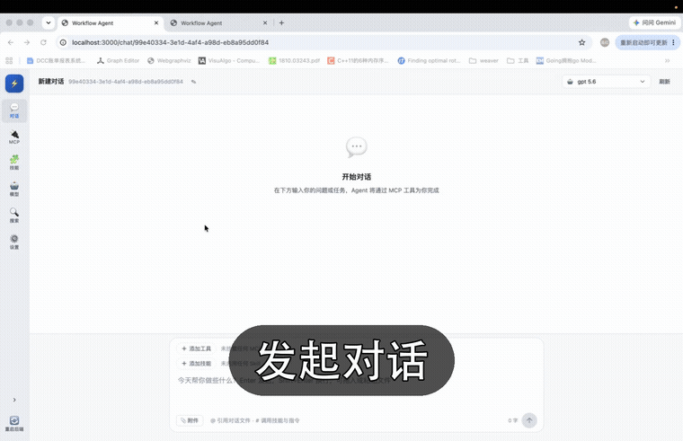

# flowagent

> 语言： [English](README.md) · [中文](README.zh-CN.md)

flowagent 是一个对话驱动的全局工作流编排框架：把自然语言对话规划成一张 DAG 子任务图，并行调度执行，前序节点的输出自动注入后续节点。内置 MCP 工具与 skill 生态，Go 后端 + React 前端。

## 目录

- [演示](#演示)
- [快速开始](#快速开始)
- [为什么选择 flowagent](#为什么选择-flowagent)
- [功能特性](#功能特性)
- [两种使用方式](#两种使用方式)
- [API 概览](#api-概览)
- [检索引擎](#检索引擎)
- [文档](#文档)
- [参与贡献](#参与贡献)
- [Star 历史](#star-历史)
- [许可证](#许可证)

## 演示

快速演示核心流程：添加模型 → 发起对话 → 规划出 DAG 工作流 → 并行执行 → 查看结果。



> ▶ 观看完整演示视频（约 9 分钟）：[YouTube](https://www.youtube.com/watch?v=11F32rEWOZQ)

## 快速开始

使用自带前端快速启动：

### 依赖

- Go 1.21+（推荐 1.25+；低于 1.25 时首次编译会自动下载对应工具链）
- Node.js 18+

### 1. 安装依赖

```bash
# Linux / macOS
bash install.sh

# Windows
install.bat
```

自动检测 Go / Node.js / Python、生成默认配置 config/config.yaml（SQLite 零依赖）、编译后端、安装前端依赖、配置 skill 运行时依赖。

> **国内网络加速（可选）**：直连 PyPI 较慢时，先设置国内镜像再安装。pip 与 uv 分别读下列环境变量：
>
> ```bash
> export PIP_INDEX_URL=https://pypi.tuna.tsinghua.edu.cn/simple      # pip：基础库、pdfkit 等
> export UV_DEFAULT_INDEX=https://pypi.tuna.tsinghua.edu.cn/simple   # uv：browser-use
> ```
>
> 想长期生效可写入 `~/.bashrc` 或 `~/.zshrc`。

### 2. 启动

```bash
# Linux / macOS
bash start.sh

# Windows
start.bat
```

会拉起后端（supervisor → server + scheduler）与前端，并自动在浏览器打开 **http://localhost:3000**。若未自动打开，可手动访问该地址。

### 3. 停止

```bash
# Linux / macOS
bash stop.sh

# Windows
stop.bat
```

停止上面启动的服务——只停当前项目目录下的进程，不会误伤其他目录启动的实例。

## 为什么选择 flowagent

1. **好用好接入的开源 agent 框架缺失**。目前没有一个好用的开源 agent 框架可供企业或个人直接接入——要么自己从零造轮子，要么只能绑定某家云厂商的云上 agent。flowagent 想做的，就是一个**好接入、功能完善的开源 agent 框架**。

2. **ReAct 串行太慢，DAG 并行加速长程任务**。现有 agent 大多是 ReAct 框架，规划出任务后只能一步步串行执行，长任务耗时长。flowagent 把任务规划成 **DAG**，让无依赖的子任务**并行执行**，显著加速长程任务的落地。

## 功能特性

- **对话 → DAG 规划**：把一段自然语言需求规划成一张有向无环图（DAG），每个节点是一个子任务，`depends_on` 表达依赖关系。
- **并行子任务调度**：无依赖的子任务并行执行，上游节点的输出自动注入下游节点。
- **上下文工程**：压缩（compaction）、索引、召回（recall），维持长会话智能体的一致性。
- **MCP 工具协议**：通过 Model Context Protocol 接入外部工具，内置 stdio / SSE / streamable_http 三种传输。
- **内置 skill 系统**：自有一等 skill（docx / pptx / shell），并打包第三方 skill（pdfkit-py、minimax-xlsx）。
- **一对话多工作流**：一个 chat 可绑定多条工作流，节点支持增量更新与版本化。
- **完整调试路径**：每个任务保留完整执行轨迹——规划思考过程、MCP 工具调用记录（输入/输出/耗时）、任务轮次、上下文用量、失败原因，并内置 pprof 端点（block / mutex profiling）定位性能问题。

## 两种使用方式

### 方式一：使用自带前端

flowagent 自带一个完整的 Web UI，包含对话、工作流 DAG 可视化、模型配置、MCP/skill 管理等功能。快速上手见 [快速开始](#快速开始)。

### 方式二：作为核心 agent 引擎（API 接入）

把 flowagent 当作你项目的「agent 内核」，通过 HTTP API 驱动。最小接入流程三步：

> 核心 API 的完整输入/输出协议与使用方法见 [docs/api.md](docs/api.md)。

```bash
# ① 创建对话
curl -X POST http://localhost:8080/api/v1/conversations/create \
  -H 'Content-Type: application/json' \
  -d '{"title":"我的任务"}'
# → {"code":0,"data":{"chat_id":"<CHAT_ID>", ...}}

# ② 发送消息（异步创建任务，返回 task_id）
curl -X POST http://localhost:8080/api/v1/conversations/chat \
  -H 'Content-Type: application/json' \
  -d '{"chat_id":"<CHAT_ID>","input_text":"帮我调研一下 X 并生成报告"}'
# → {"code":0,"data":{"task_id":"<TASK_ID>"}}

# ③ 流式接收结果（SSE）或轮询任务详情
curl -N "http://localhost:8080/api/v1/tasks/stream?task_id=<TASK_ID>"
curl -X POST http://localhost:8080/api/v1/tasks/detail \
  -H 'Content-Type: application/json' \
  -d '{"task_id":"<TASK_ID>"}'
```

任务分两种类型（`task_type`）：

| 类型 | 含义 | 输出结构 |
|---|---|---|
| `SINGLE_AGENT` | 单 agent 直接处理（理解 → MCP 工具调用 → 返回） | `agent_output` |
| `WORKFLOW_AGENT` | 先规划 DAG，再并行执行子任务 | `workflow_output`（含 `nodes` 依赖图） |

## API 概览

所有接口位于 `/api/v1` 下，统一 JSON 包装 `{"code":0,"msg":"...","data":...}`。除 SSE 与文件上传/下载外均为 `POST`。

| 模块 | 端点 | 说明 |
|---|---|---|
| 对话 | `POST /conversations/create` | 创建对话 |
| | `POST /conversations/chat` | 发消息，返回 `task_id` |
| | `POST /conversations/list` / `detail` / `delete` | 列表 / 详情 / 删除 |
| | `POST /conversations/mcp/*` · `/skills/*` | 对话级 MCP / skill 绑定 |
| 任务 | `POST /tasks/detail` / `stop` / `retry` / `turns` | 任务详情 / 停止 / 重试 / 轮次 |
| | `GET /tasks/stream` | SSE 流式输出 |
| 模型 | `POST /models/list` / `create` / `update` / `delete` / `set-default` / `test` / `status` | 全局模型配置 |
| MCP | `POST /mcp/servers/*` | MCP 服务器增删改查、连接测试、内置清单导入 |
| Skill | `POST /skills/*` | skill 增删改查、内置清单导入、zip 导入 |
| 文件 | `POST /files/upload` · `GET /files/download` / `open` | 工作区文件上传 / 下载 / 本地打开 |
| 设置 | `POST /settings/db/*` · `POST /search-config/*` | 数据库连接、检索引擎配置 |

完整的数据结构定义见 [`api/v1/workflow_agent.proto`](api/v1/workflow_agent.proto)。

## 检索引擎

`web_search` / `deep_search` 使用可插拔的搜索引擎（由全局 search_config 配置，可在前端「搜索」页或 `POST /search-config/*` 接口设置）：

| 引擎 | 是否需 key | 说明 |
|---|---|---|
| **baidu**（默认） | 否 | 零 key、开箱即用，中文内容覆盖好；但英文/国际内容覆盖较弱，高频调用可能触发安全验证 |
| **serper** / **bocha** / **tavily** | 是 | 商业搜索 API，结果更稳定、结构化、英文覆盖好，需各自 API key |

**百度与其他引擎的区别**：百度是免费零 key 的默认引擎，适合开箱体验与中文场景；商业 API（Serper / Bocha / Tavily）结果质量更高、结构化更好、对英文与国际化内容覆盖更强，适合生产与高质量检索，但需付费 key。未配置任何 key 时，系统自动回落百度。

## 文档

- [技术架构与实现理念](docs/architecture.md) —— 整体的技术架构与实现理念，分模块详解整个 agent 的实现（代码目录结构也在这里）。
- [核心 API 参考](docs/api.md) —— 作为 agent 内核（HTTP API 接入）的完整输入/输出协议与使用方法。

## 参与贡献

flowagent 是开源项目，欢迎一起开发。我们正在招募协作者，一起完善这个框架——修 bug、接入新的 MCP/skill、改进前端、完善文档都可以。

- 提 issue 报告 bug 或提出新需求。
- Fork 仓库后提交 pull request。
- 有问题、有想法，或想成为维护者，欢迎联系：**zhengaohong@gmail.com**。

### 待改进 / Roadmap

框架仍在持续演进，以下方向尚待完善，欢迎社区共建：

- **全局记忆**：目前缺乏跨对话的长期记忆（用户偏好、历史决策的沉淀），是下一步的重点方向。
- **内置知识库**：暂未内置向量知识库，需要外挂知识库（RAG）技能来补足检索增强能力。

如果你对以上任一方向感兴趣，欢迎认领 issue 或直接提交 PR，一起把 flowagent 做得更好。

## Star 历史

[](https://star-history.com/#memory-overflow/flowagent&Date)

## 许可证

[MIT License](LICENSE)。

第三方组件许可详见 [NOTICE](NOTICE)。其中 `skills/pdfkit-py` 依赖 PyMuPDF（AGPL-3.0），该目录不受本仓库 MIT 许可证覆盖，启用该 skill 需自行遵守 AGPL 条款。
